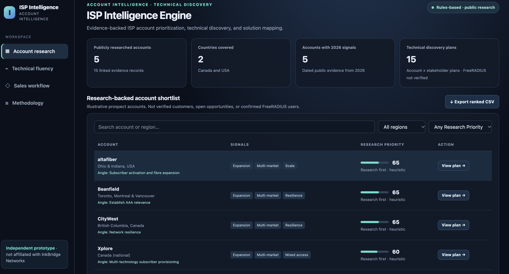
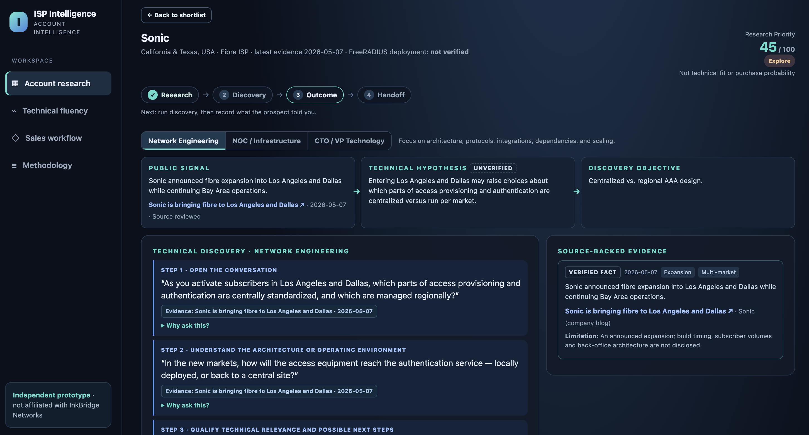
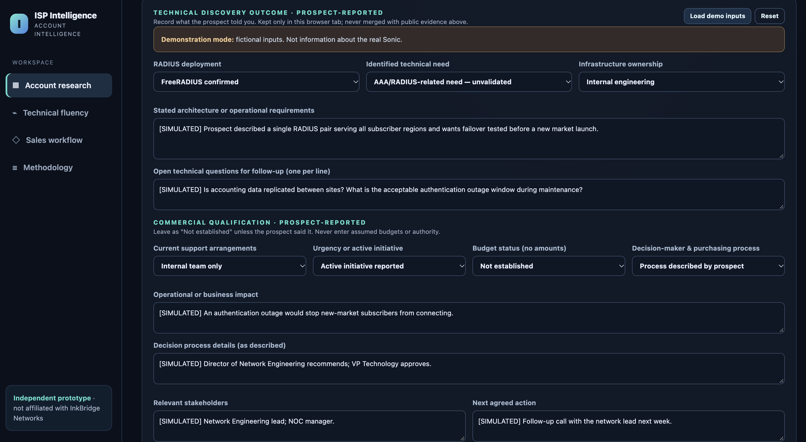

# ISP Intelligence Engine

**Evidence-backed ISP account research, technical discovery, and engineering handoff.**

[**Launch the live application**](https://source-to-studio-bridge.lovable.app)

> **Independent portfolio prototype.** Built using publicly available research and InkBridge Networks' published service information. This project is not affiliated with, sponsored by, or endorsed by InkBridge Networks. The accounts shown are research examples—not verified InkBridge customers, active opportunities, or confirmed FreeRADIUS users.

## Why I built it

In technical B2B sales, a company expansion announcement may be a reason to investigate an account, but it is **not evidence of an authentication problem, an existing FreeRADIUS deployment, or buying intent**.

I built this prototype to explore a more disciplined way for a business development professional to move from a public account signal to a credible technical conversation—and, only when warranted, to a useful handoff for engineering or commercial follow-up.

The intended users are business development representatives, partnership and account managers, and technical sales specialists working with network infrastructure buyers.

## What the application does

| Stage | User action | Output |
| --- | --- | --- |
| **1. Research** | Compare five curated ISP accounts; search, filter, adjust public-signal weights, and export a ranked CSV. | An explainable **Research Priority** score, not a measure of technical fit or purchase probability. |
| **2. Discovery** | Select Network Engineering, Network Operations (NOC) / Infrastructure, or CTO / VP Technology. | An account- and persona-specific three-question plan linked to public evidence, technical hypotheses, and follow-ups. |
| **3. Qualification** | Record simulated or prospect-reported technical findings and optional commercial context. | Transparent next-action guidance that separates unclear needs, potentially relevant AAA/RADIUS needs, and no demonstrated RADIUS opportunity. |
| **4. Handoff** | Generate a brief from the research and recorded findings. | A copyable technical/commercial summary; when there are no technical findings, the output is labelled a **pre-call research summary**, not a completed handoff. |

The prototype includes **five ISP accounts**, **three stakeholder personas**, and **15 curated discovery plans**. Account research and question sets are static and reviewed; the application applies deterministic rules rather than generating answers with a live AI model.
## Application Preview

### 1. Account Intelligence
Research and prioritize ISP accounts using public expansion signals and explainable scoring.



### 2. Evidence-Based Technical Discovery
Connect public research signals to technical hypotheses and stakeholder-specific discovery questions.



### 3. Technical and Commercial Qualification
Record discovery findings, evaluate technical relevance, and determine appropriate next steps. This example uses fictional demonstration data.



---
## Try the demo

1. [Open the application](https://source-to-studio-bridge.lovable.app) and select **Sonic** from the account shortlist.
2. Switch between **Network Engineering** and **CTO / VP Technology**. Expand **Why ask this?** to see the evidence, technical reasoning, and follow-up behind each question.
3. Open **Outcome** and choose **Load demo inputs**. All sample call findings are explicitly marked **SIMULATED**; they are not facts about Sonic.
4. Review the suggested next action, then generate and copy the **Handoff Brief**.
5. Change a discovery field and observe the previous brief become out of date. Regenerate the brief, or reset the demo to return to an unknown state.

You can also compare **Beanfield**, where limited public evidence intentionally does not justify a specific AAA/RADIUS service recommendation. This is a deliberate example of avoiding an unsupported pitch.

## How qualification works

The qualification outcomes are deliberately conservative:

- **A — Further qualification required:** No explicitly relevant AAA/RADIUS need has been established, or its relevance remains unclear. Merely confirming FreeRADIUS use does not create an opportunity.
- **B — Potential specialist discussion:** An AAA/RADIUS-related need has been reported, but it still requires engineering validation. **This is not a fully qualified commercial opportunity.**
- **C — No demonstrated RADIUS opportunity:** The reported need is absent, unrelated to AAA/RADIUS, or there is no relevant RADIUS use case. Other InkBridge offerings are not automatically ruled out.

Commercial fields—such as support model, urgency, budget, decision process, and stakeholders—add context to the handoff but **do not automatically promote an account** into a higher category.

## Technical implementation

- **Stack:** React 19, TypeScript, TanStack Start / TanStack Router, Vite, Tailwind CSS, and Bun.
- **Application UI:** `src/routes/index.tsx` mounts the application; `src/lib/isp-markup.ts` and `src/lib/isp-app.ts` contain its migrated markup and interaction controller.
- **Research and discovery:** `src/lib/discovery-data.ts` holds source-linked account evidence, hypotheses, InkBridge service references, and curated questions. `src/lib/discovery.ts` assembles the persona-specific plans.
- **Qualification and handoff:** `src/lib/outcome.ts` implements deterministic next-action rules, progress state, and brief generation.
- **Data handling:** Discovery inputs exist only in the active browser tab's memory and are cleared on refresh. Simulated findings remain separate from public account research.

There is **no backend, database, login system, CRM integration, automated account scraping, live AI inference, or automatic research refresh**. Copy-to-clipboard and CSV export run in the browser.

## Evidence standards and limitations

Every evidence record includes a source, publication date when available, a verification status, and a limitation. The interface separates **published facts**, **unverified technical hypotheses**, and **unknowns or prospect-reported information**.

- **Source reviewed** means the referenced publication was reviewed for the stated claim; it is not a guarantee of ongoing accuracy.
- **Source requires verification** means the claim or link needs further checking before external use.
- The Xplore Alberta fixed-wireless expansion record references [Xplore's official February 3, 2026 announcement](https://www.xplore.ca/about/news/xplore-awarded-federal-and-provincial-funding-to-expand-ultra-fast-fixed-wireless-internet-across-rural-alberta/). It concerns **announced funding and planned expansion**, not proof of completed deployments or authentication requirements.
- None of the five accounts has a publicly verified FreeRADIUS deployment in this dataset. Fibre expansion, network resilience, and subscriber growth do not establish AAA problems or purchasing intent.
- Hypotheses and suggested InkBridge service areas must be validated through discovery and, when appropriate, specialist review. Simulation data must never be represented as real prospect conversations.

This is a five-account demonstration of a workflow—not a production research platform, validated lead-scoring system, or proven revenue-generation process.

## Run locally

**Requirements:** A current Node.js version supported by the project's Vite release, plus [Bun](https://bun.sh/).

```bash
git clone https://github.com/marshallreed63-lab/isp-technical-discovery-engine.git
cd isp-technical-discovery-engine
bun install
bun run dev
```

Open the local address displayed in your terminal. No API keys or backend setup are needed. To build the project, run `bun run build`.

## Tests and quality assurance

```bash
bun run test
bun run build
```

The test suite covers the source-to-hypothesis mappings, role-specific plans, qualification states, handoff behavior, and application routing. Browser checks cover account selection, filters, scoring sliders, clipboard actions, CSV export, demo-data isolation, and mobile interactions. For the recorded pre-release testing history, see [QA_REPORT.md](QA_REPORT.md); rerun the commands above against the current commit.

## Development approach and next steps

This application was built and iterated using **Lovable and AI-assisted development**. The emphasis was on defining the sales workflow, structuring source-grounded discovery, designing conservative qualification rules, testing edge cases, and refining the user experience. The project does not claim independently hand-written code, real customer deployments, or measured business outcomes.

Possible future extensions include reviewed source-refresh workflows, secure storage of consented discovery data, AI-assisted research with citations, and CRM handoff. Those features are **not implemented** in this prototype and would require additional validation, access controls, and privacy considerations.
